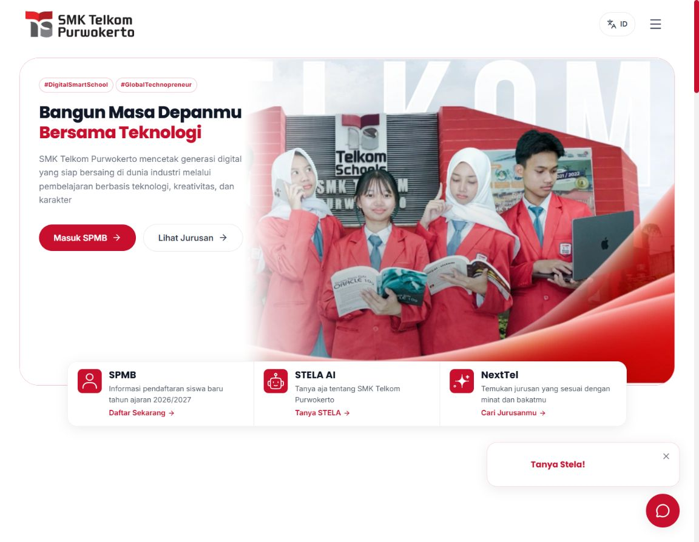
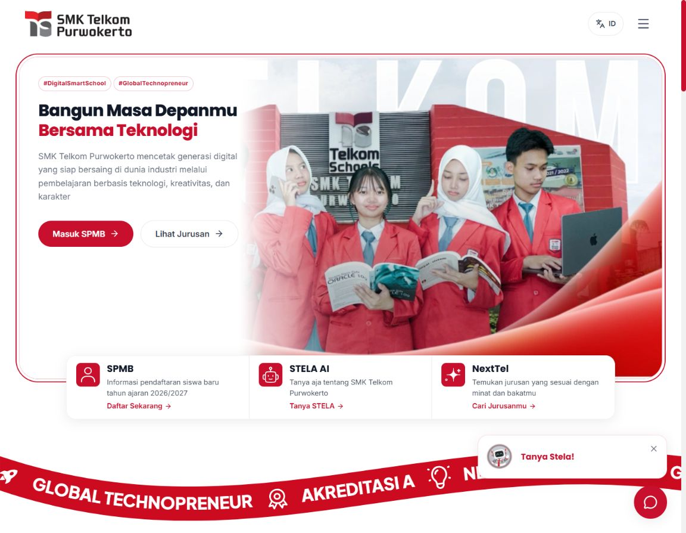

Audit bagian atas artwork hero — 2 November 2026

Penyebab: pada lebar desktop 1160px, kanvas media 70% dipasang dalam hero setinggi 544px dengan object-fit contain dan posisi bottom. Gambar Beranda hanya terlukis setinggi sekitar 427px di dalam kanvas 542px, menyisakan sekitar 115px strip kosong di atas. Fasilitas juga membatasi lebar kanvas secara terpisah.

Perbaikan: lebar media komposit dihitung dari tinggi hero dan rasio artwork masing-masing. Artwork tetap contain, mempertahankan rasio, dan mencapai tepi atas serta bawah. Profil sekolah memakai rasio sumber 1600/751. Perubahan terbatas pada desktop carousel; layout bertumpuk mobile dan foto biasa tidak diubah. Pada desktop sempit, artwork dapat membentang ke kiri di belakang area copy yang sudah memiliki latar putih; ini mempertahankan tinggi gambar tanpa crop vertikal. Mask serta crop sumber khusus existing tidak dihapus.

Verifikasi browser:
- Seluruh 12 slide Beranda pada 390, 768, 1024, 1160, 1280, dan 1440px: tanpa strip kosong besar, copy keluar panel, atau horizontal overflow.
- Sebelas halaman tambahan pada 1160 dan 390px: fasilitas, jurusan, prestasi, profil sekolah, guru, ekstrakurikuler, BKK, berita, pengumuman, kalender, dan SPMB.
- Versi Inggris seluruh 12 halaman pada 1160px; SPMB Inggris juga diperiksa pada enam lebar layar di atas.
- Semua gambar hero yang diaudit telah dimuat pada pemeriksaan Inggris.
- Audit permanen scripts/hero-layout-audit.mjs memeriksa bounds heading, paragraf, CTA, image letterboxing, gambar belum dimuat, dan horizontal overflow. Seluruh 12 halaman Inggris lulus.
- Transisi normal dari slide Fasilitas ke Jurusan selesai; keyboard dan pergantian reduced motion bekerja. Tidak ada console error.
- Lint, typecheck, tes posisi innovation, 22 tes animasi existing, dan production build/prerender 146 route lulus.

Ulangi audit pada dev server melalui console browser:

```js
(await import('/scripts/hero-layout-audit.mjs')).auditHeroLayout(document)
```

Hasil mentah ada di results.json. Audit tidak menilai mask/crop yang memang tertanam di aset sumber atau perubahan desain halaman lain. Perangkat fisik dan Safari belum diuji.




