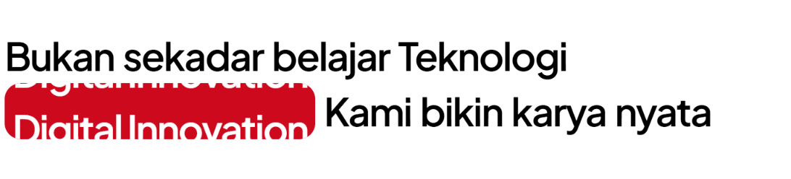
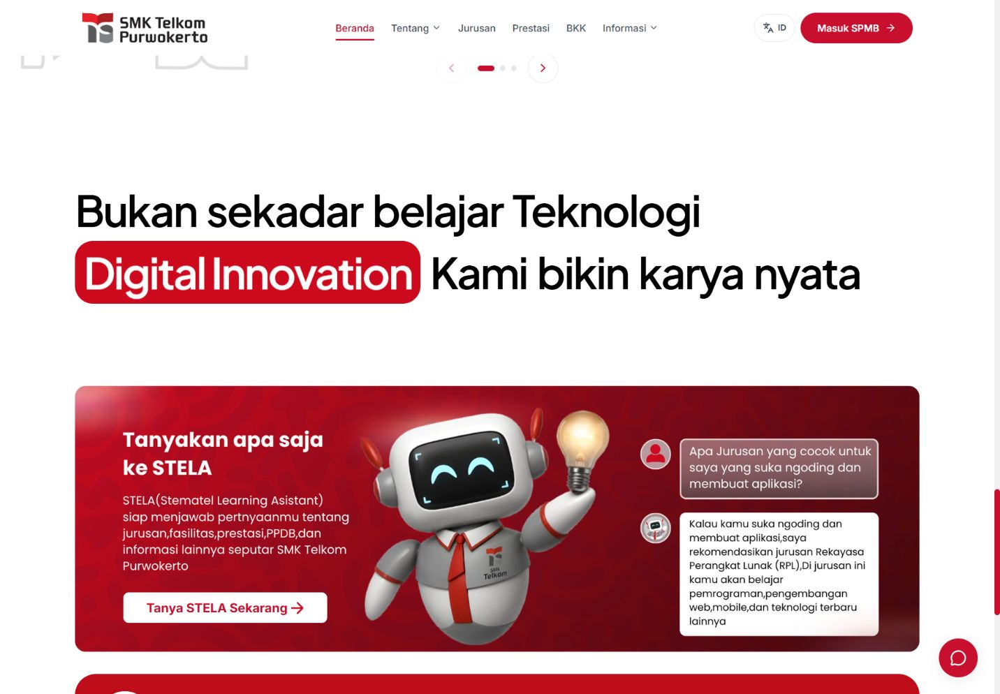
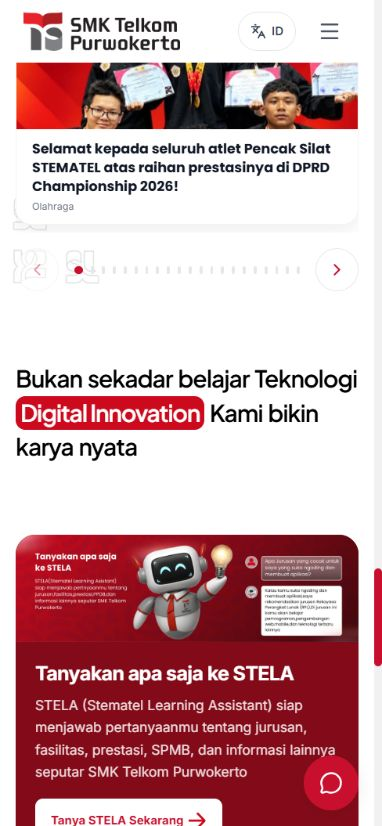

Text reveal dan horizontal innovation loop — 1 November 2026

Referensi desain: [Figma, halaman Telkom again](https://www.figma.com/design/ca2iX76GpJSr0QC7Qyv9RV/Figma-MCP?node-id=261-1476&m=dev).

Section ditempatkan setelah konten utama/prestasi dan sebelum STELA: teks Figma dimulai pada y=7977, kotak merah y=8117, banner STELA y=8353. Font Plus Jakarta Sans 600, proporsi radius 40/96 em, warna merah #cd091d, dan container mengikuti desain serta layout responsif situs.

Frasa tunggal “Digital Innovation” diulang melalui dua sel horizontal identik. Track selebar 200% bergerak dengan GSAP xPercent 0 ke -50; mask mempertahankan ukuran kotak. Reveal memakai stagger opacity 0,7 ke 1 dan warna abu-abu ke hitam, tanpa perubahan posisi kata. Scrub 0,35 mengikuti scroll maju maupun mundur. Loop baru berjalan ketika reveal selesai dan section terlihat. Scroll mundur mengembalikan frasa utuh.

ResizeObserver pada main memperbarui batas ScrollTrigger melalui requestAnimationFrame setelah tinggi konten lazy/API berubah. Observer, listener, frame, dan GSAP context dibersihkan saat unmount, pergantian bahasa, atau reduced motion. Referensi teknik: [dokumentasi resmi ScrollTrigger](https://gsap.com/docs/v3/Plugins/ScrollTrigger/).

Verifikasi browser lokal:
- Desktop 1440 × 1000, tablet 768 × 1024, mobile 390 × 844 dan 320 × 800.
- Tidak ada horizontal overflow; kata dan frasa di dalam kotak muat. Kedua sel memiliki tinggi yang sama dengan mask, tanpa clipping vertikal.
- Tiga reset loop diamati selama 11,2 detik. Semua transform berada pada sumbu X. Posisi dokumen serta ukuran kotak stabil. Lihat [loop-metrics.json](loop-metrics.json).
- Scroll ke atas mengembalikan teks menjadi rgb(153,153,153) dan opacity 0,7; scroll masuk kembali menghasilkan hitam dan opacity 1. Highlight tetap putih.
- Timeline diuji pada progres 0, 0,5, 1, 0,5, 0: warna reversibel dan seluruh posisi Y tetap 0.
- Penambahan spacer sementara 360 px di atas section menggeser start ScrollTrigger 360 px; setelah spacer dihapus, start kembali ke nilai semula.
- Pergantian ID/EN mempertahankan frasa penuh dan layout. Label English: “More than learning Technology” dan “We create real work”.
- Reduced motion menghentikan loop, menghapus ScrollTrigger section, dan menampilkan semua kata pada opacity 1. Mengembalikannya memasang tepat satu trigger.
- Navigasi SPA ke /jurusan menghapus trigger section; kembali ke / memasang tepat satu instance.
- Tidak ada console error selama pengujian.

Perintah verifikasi:
- npm run lint
- node scripts/uji-innovation-layout.mjs
- node scripts/uji-wave-marquee.mjs
- npm run animasi:uji — 22 skenario existing.
- npm run bahasa:uji — termasuk 81 rendered views dan 4 content records.
- npm run build — Vite dan prerender 146 route publik.
- git diff --check

Screenshot before berasal dari referensi bug yang diberikan pengguna. Screenshot after menunjukkan section di posisi akhir sebelum STELA; mobile menggunakan reduced motion agar frasa tampil utuh.

Batas verifikasi: menggunakan emulasi viewport browser lokal; perangkat fisik dan Safari belum diuji. Tidak ada merge atau deployment yang dilakukan.
